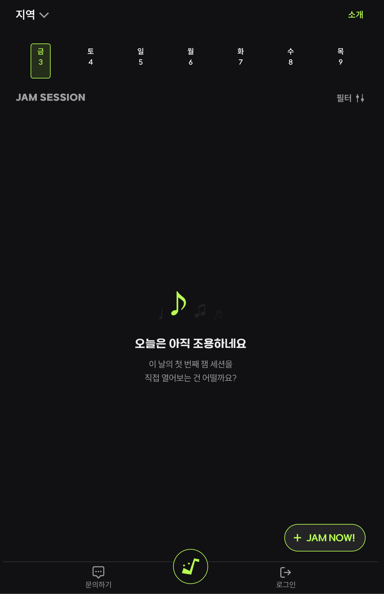
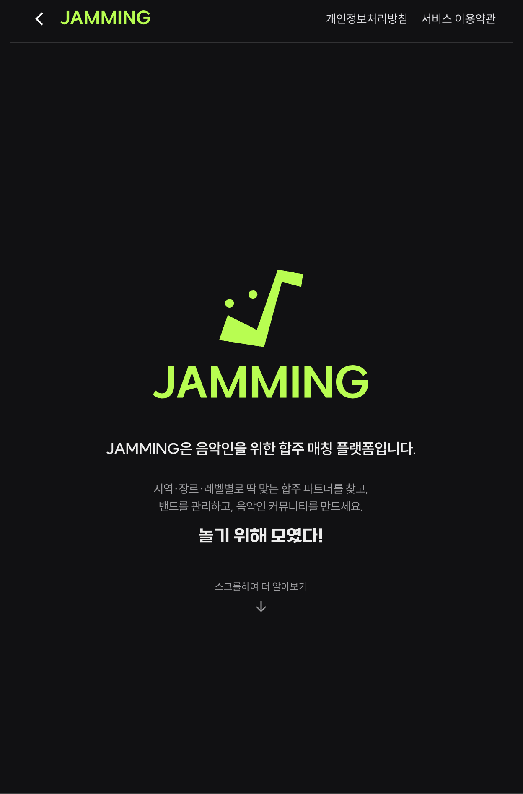

<div align="center">

# 🎸 JAMMING

**A mobile-web platform for matching musicians for jam sessions & band practice**

Helps amateur/hobby musicians in Korea find people to play with — hosting or joining jam sessions based on region, genre, and skill level.

[**🌐 Live Demo → jamming.co.kr**](https://jamming.co.kr) <sub>(UI demo · database disconnected)</sub>

[](https://github.com/bswebdevlpr/Jamming/actions/workflows/test.yml)
[](https://nextjs.org/)
[](https://react.dev/)
[](https://www.typescriptlang.org/)
[](https://supabase.com/)
[](./LICENSE)

</div>

---

## 📖 Overview

**JAMMING** is a mobile-only (PWA) web service for amateur and hobbyist musicians in Korea. A host opens a jam session, other musicians apply with their instrument/position, and the host approves applicants — completing the match.

> ⚠️ This repository is public **for portfolio purposes**. No production infrastructure (Supabase instance, API keys, etc.) is included; all secrets are kept in environment variables.

## 📱 Screenshots

<div align="center">
<table>
  <tr>
    <td align="center"><br/><sub>Home</sub></td>
    <td align="center"><br/><sub>About</sub></td>
  </tr>
</table>
</div>

## ✨ Features

| Feature | Description |
| --- | --- |
| 🎵 **Jam Session CRUD** | Create/edit/delete sessions with date, venue, genre, skill level, per-position headcount, and a setlist |
| 🙋 **Apply & Approve** | Apply by position, host approval/rejection, and re-application (re-jam) flow |
| 🔔 **Notifications** | Alerts for apply/approve/reject events; open-chat link revealed on approval |
| 🗺️ **Region Filter** | Browse and filter sessions across 19 regions |
| 🔍 **Song & Venue Search** | Integrations with ManiaDB (songs) and Naver Map (venues) |
| 👤 **Profile & My Page** | Manage position, genre, skill level, tags, and playlist |
| 🔐 **Kakao OAuth** | Authentication via Kakao social login |

## 🛠️ Tech Stack

| Category | Technology |
| --- | --- |
| **Framework** | Next.js 16 (App Router, Server Actions) |
| **Language** | TypeScript |
| **UI** | React 19 RC · Tailwind CSS 4 · Framer Motion · MUI · Radix UI |
| **State** | Zustand · TanStack React Query 5 |
| **Form / Validation** | React Hook Form · Zod |
| **Backend** | Supabase (Auth · Postgres · Storage) |
| **Infra** | Vercel · Upstash Redis (rate limiting) |
| **External APIs** | ManiaDB (songs) · Naver Map (venues) · Kakao (OAuth) |
| **Testing** | Vitest · React Testing Library · Playwright · MSW |

## 🏗️ Architecture

- **Mobile-first**: fixed `375px ~ 600px` viewport with touch-optimized UI (bottom sheets, swipe gestures)
- **Server Actions–based CRUD**: minimizes client bundle and handles data server-side
- **Domain-oriented structure**: per-page `functions/` directories isolate data-access logic
- **Type safety**: single source of truth between Zod schemas and TypeScript interfaces
- **Test coverage**: four layers — unit · integration · component · e2e

```
app/
├── (pages)/
│   ├── (signin)/          # Public area (login, sign-up)
│   ├── (only-user)/       # Auth-required area (jam sessions, my page)
│   └── layout.tsx         # Global providers
├── api/                   # Server Actions & Route Handlers
│   ├── functions/         # CRUD server functions
│   ├── maniadb/ · naver/  # External API proxies
│   └── auth/              # OAuth callback
├── lib/                   # enums, interfaces, zod schemas, utils
├── stores/                # Zustand stores
├── ui/                    # design system, shared components
└── util/supabase/         # Supabase client/server helpers
__tests__/                 # unit · integration · component · e2e
docs/                      # architecture · patterns · design · reference docs
```

## 💡 Engineering Highlights

- **iOS Safari compatibility** — the most heavily debugged area of the project: a dynamic `--vh` CSS variable to handle the changing address-bar height, auto-zoom prevention (`maximum-scale=1`), and layout stabilization during keyboard input.
- **Server Actions for all mutations** — CRUD runs server-side to keep the client bundle lean and secrets off the client.
- **Rate limiting** — Upstash Redis guards write-heavy endpoints against abuse.
- **End-to-end type safety** — Zod schemas double as runtime validators and the source of TypeScript types, eliminating drift between validation and types.
- **Four-layer testing** — unit, integration, component, and Playwright e2e, with external APIs mocked via MSW for deterministic runs.

## 🚀 Getting Started

### Prerequisites

- Node.js 20+
- **pnpm** (required — do not use npm/yarn)
- A Supabase project (Auth · DB · Storage)

### Installation & Run

```bash
# 1. Install dependencies
pnpm install

# 2. Configure environment variables (see .env.example)
cp .env.example .env
#    → fill in real values in .env

# 3. Start the dev server (http://localhost:3038)
pnpm dev
```

> `NEXT_PUBLIC_SUPABASE_URL` must be set — it drives Supabase auth/storage and the `next/image` allow-list. If it's missing, Supabase-hosted images (e.g. profile photos) won't load.

### Scripts

| Command | Description |
| --- | --- |
| `pnpm dev` | Dev server (`:3038`) |
| `pnpm build` | Production build |
| `pnpm start` | Production server |
| `pnpm lint` | Run ESLint |
| `pnpm test` | Unit/integration tests (watch) |
| `pnpm test:run` | Run tests once |
| `pnpm test:coverage` | Coverage report |
| `pnpm test:e2e` | Playwright E2E tests |

## 🧪 Testing

Unit/integration/component tests run on Vitest, with end-to-end tests on Playwright.
External API calls are mocked with **MSW**.

```bash
pnpm test:run        # unit · integration · component
pnpm test:e2e        # e2e
```

## 📚 Documentation

Detailed design docs live in [`docs/`](./docs).

| Doc | Contents |
| --- | --- |
| [Context](./docs/context/README.md) | Project overview · domain model |
| [Architecture](./docs/architecture/README.md) | System structure |
| [Patterns](./docs/patterns/README.md) | Code patterns |
| [Design](./docs/design/README.md) | Design system guide |
| [Reference](./docs/reference/README.md) | API · schema reference |

## 📄 License

© 2026 bswebdevlpr. All rights reserved. See [LICENSE](./LICENSE).

This repository is public for **portfolio viewing only** — reuse, copying, or redistribution of the code is not permitted.
